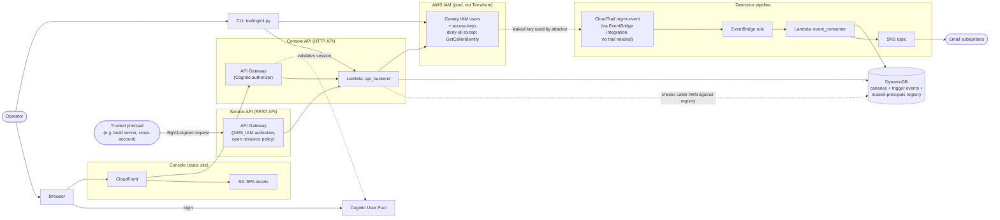
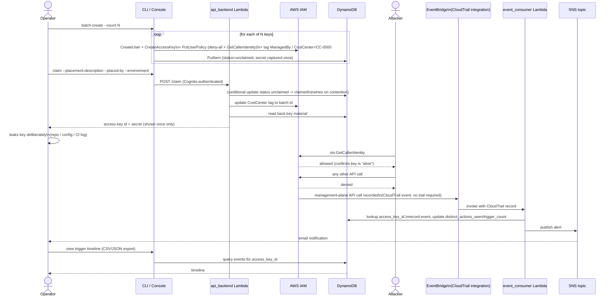

# TrippyCreds

Mint, manage, and audit AWS credential canaries.

Canary tokens — honeytokens for credentials — have always been one of the
more interesting cheap security controls: a credential with no legitimate
purpose except to be stolen, so any use of it is a near-certain signal
instead of a probabilistic one. What motivated building this one
specifically is agentic risk: agents are very good at getting the job done,
and that means they don't reliably fail safely when blocked — they
improvise, retry down unpredictable paths, and pick up whatever credential
happens to be reachable to push a task over the line. TrippyCreds exists to
catch that moment: a trigger means an agent (or a human) went out of
bounds — escaped its expected isolation, or got too creative with
credentials while chasing an objective.

TrippyCreds generates disposable AWS IAM access keys with zero real
permissions, meant to be leaked deliberately — in a repo, a config file, a
CI log, wherever — so that any use of them at all is a strong, unambiguous
signal of compromise. It's a honeytoken system, but with one deliberate
difference from most: canaries are pre-provisioned into a pool and then
*claimed* one at a time, with the secret shown exactly once at claim time.
That gives a strict one-key-to-one-identity mapping, which is what makes
attribution reliable — you always know exactly which placement a triggered
key belongs to.

Full design rationale, trade-offs, and the handful of things we hit (and
worked around) deploying this into a real AWS Organization live in
[DESIGN.md](DESIGN.md).

## How it works, briefly

- **Pool model**: a batch job creates IAM users + access keys ahead of time,
  tagged and policed with a deny-everything-except-`sts:GetCallerIdentity`
  inline policy. They sit unclaimed until needed.
- **Claim, don't pick**: claiming allocates *any* unclaimed key atomically and
  attaches your placement metadata (where it's going, who placed it,
  environment) — you never choose a specific key, and the secret is only
  ever shown at that moment.
- **Detection**: EventBridge's built-in CloudTrail integration (no trail
  required) catches management-plane API calls made with a canary key,
  matches the access key ID against DynamoDB, records the event, and
  publishes an SNS alert.
- **Console**: a small Cognito-gated web app (static S3/CloudFront frontend,
  API Gateway + Lambda backend) to list canaries, view a trigger timeline,
  claim, batch-create, and purge the unclaimed pool.
- **CLI**: the same operations, scriptable, for anyone who'd rather not open
  a browser.

## Use cases

The agentic-risk case that motivated this project: place a canary somewhere
an in-bounds agent has no reason to look — a config file outside its
intended working tree, a secrets store it wasn't given access to, a bucket
adjacent to the one it's actually supposed to use. Any trigger turns "did
the agent do what I asked" into a much more useful "did the agent go
somewhere it shouldn't have to get there." A few concrete shapes this takes:

- **Sandbox/isolation escape detection** — drop a canary outside an agent's
  intended filesystem, account, or network boundary; a trigger means the
  sandbox didn't hold.
- **Excessive-agency detection for coding/ops agents** — place a canary alongside
  real credentials an agent is *not* supposed to touch (a prod key next to a
  dev key, an admin key next to a scoped one); a trigger means the agent
  reached past the scope it was given.
- **Traditional leak detection** — the original honeytoken use case: canaries
  committed to repos, baked into CI logs, dropped in config files, so a leak
  (human or automated) shows up as an unambiguous signal.
- **Insider / lateral-movement detection** — canaries placed as bait
  resources inside an environment, independent of agents entirely, to catch
  anyone poking around where they shouldn't be.

## Architecture

Terraform owns everything below except the canary IAM users/access keys
themselves — those are ephemeral and managed only by the Python tooling and
the API Lambda (see [DESIGN.md](DESIGN.md)).



## Sequence: lifecycle of a canary

From pool creation through a leaked key being used and alerted on.



## Design notes

Short version of the reasoning behind a few choices that aren't obvious
from the diagrams alone. Full detail in [DESIGN.md](DESIGN.md).

**The 5,000-user ceiling.** IAM caps an account at 5,000 IAM Users, and it's
a hard limit, not a standard service quota you can request an increase
on — it also counts every IAM User in the account, not just canaries.
`batch-create` checks `iam:GetAccountSummary` before creating anything and
fails fast with a clear error if a batch would exceed headroom, rather than
dying partway through with no record of how far it got.

**One access key per IAM user, forever.** Each canary user is created with
exactly one access key, and its inline policy denies that user from ever
calling `iam:CreateAccessKey` on itself. This is deliberate, not
incidental: if a leaked key's holder could mint themselves a second key, the
one-key-to-one-identity mapping that makes attribution reliable would
break — you'd no longer know for certain that a trigger traces back to the
specific placement you recorded. No rotation either; a retired canary is
deleted outright (user + key together), never rotated, which also sidesteps
AWS only returning a secret at creation time.

**No IAM user re-use.** A retired or purged canary's IAM user is deleted,
not recycled into a new canary. Re-use would blur the attribution boundary
the whole system exists to protect — a trigger event needs to map
unambiguously to one placement, at one point in time, forever. DynamoDB
keeps a permanent `deleted` row (secret scrubbed, metadata intact) so the
identity and history persist even after the real IAM resources are gone.

**Persistence: DynamoDB, not the IAM users themselves.** IAM users and their
access keys are treated as ephemeral — Terraform never touches them, only
the Python tooling and the API Lambda do. DynamoDB is the durable,
authoritative record: one table keyed on `access_key_id` tracking status
(`unclaimed`/`claimed`/`deleted`), placement metadata, and trigger rollups,
plus a second collection of raw per-event rows (one per matched CloudTrail
event) that the console renders as a timeline. IAM tags (`ManagedBy`,
`CostCenter`) mirror a sliver of this state back onto the live resources so
a reconciliation job can diff IAM against DynamoDB, but DynamoDB is the
source of truth.

**Permissions model.** Every canary IAM user carries a deny-all inline
policy with one explicit carve-out: `Allow sts:GetCallerIdentity`. The
allow exists so a leaked-key finder's near-universal first move ("is this
key even alive?") succeeds — that keeps them engaged long enough to try
something else, which is itself a signal — while every other action,
including self-service key creation, stays denied. The explicit `Deny *:*`
baseline wins over any policy-evaluation ordering quirk, including a future
Service Control Policy (SCP) misconfiguration.

**Run it in a dedicated account, with an SCP outside that account.** This
system should live in its own AWS account with no other workloads in it —
canaries sharing an account with real resources muddies both the blast
radius and the signal. The inline per-user policy is the first layer of
defense, but it's enforced inside the account it's trying to protect; a
second layer belongs one level up, as an Organization-level SCP (set from
the management account or a delegated admin — outside this account's own
Terraform and credentials entirely) that restricts anything
tagged `ManagedBy=platform-automation` to effectively nothing. That way a
misconfigured inline policy isn't the only thing standing between a canary
and real permissions.

**Scaling past 5,000: N+1 accounts, not a bigger account.** Because the
5,000-user ceiling is per-account and not raisable, the scaling story is
horizontal rather than vertical — stand up a second dedicated account
running the same Terraform root, point it at its own DynamoDB table, and
the pool effectively doubles. Nothing about the data model or tooling
assumes a single account; growing past one account's ceiling is just
provisioning account N+1, not a redesign.

## Prerequisites

- A dedicated AWS account for this (don't mix canaries into an account doing
  real work)
- [Terraform](https://developer.hashicorp.com/terraform) >= 1.5
- Python 3.12+ and `boto3` (`pip install -r requirements.txt`)
- An AWS CLI/SSO profile with admin-level access to that account

## Deploying

```sh
cd terraform
cp terraform.tfvars.example terraform.tfvars
# edit terraform.tfvars: your AWS profile, region, the account ID you expect
# to be deploying into, and the email(s) that should get trigger alerts

terraform init
terraform plan
terraform apply
```

`expected_account_id` is checked against the account your profile actually
resolves to before anything is created — a guard against applying with the
wrong profile.

CloudFront distributions take 15-20 minutes to deploy; that's expected, not
a hang.

After applying, create yourself a console login (self-service sign-up is
disabled on purpose):

```sh
aws cognito-idp admin-create-user \
  --user-pool-id "$(terraform output -raw cognito_user_pool_id)" \
  --username you@example.com \
  --user-attributes Name=email,Value=you@example.com Name=email_verified,Value=true \
  --message-action SUPPRESS

aws cognito-idp admin-set-user-password \
  --user-pool-id "$(terraform output -raw cognito_user_pool_id)" \
  --username you@example.com \
  --password 'some-temporary-password'
```

Cognito's Hosted UI will prompt for a real password on first login. The
console URL is `terraform output console_url`.

## Using it

**CLI** (from the repo root, with `terraform output` reachable so it can
self-configure — see `trippycreds/config.py`):

```sh
python -m tooling.cli batch-create --count 10
python -m tooling.cli list-pool --status unclaimed
python -m tooling.cli claim --placement-description "leaked in github.com/org/repo" \
  --placed-by "you" --environment "prod-honeypot"
python -m tooling.cli purge-unclaimed --execute
```

`batch-create` and `claim` never print the secret except at the moment
`claim` returns it — copy it immediately, it's not retrievable again.

**Console**: open `console_url`, log in, and use the dashboard — claim,
batch-create, purge, view each canary's full trigger timeline with CSV/JSON
export, and manage trusted principals for the service API below.

**Service API** (cross-account, no operator in the loop — e.g. a build
server claiming a canary to inject into a host it provisions): register the
caller's ARN first, from the console's "Trusted principals" panel or the
CLI —

```sh
python -m tooling.cli register-principal --arn arn:aws:iam::222233334444:role/build-server-role \
  --label "ci-build-server" --environment "prod-honeypot"
```

— then have that principal call `terraform output -raw service_claim_api_url`
directly, SigV4-signed with its own AWS credentials (no Cognito session
involved):

```sh
curl --aws-sigv4 "aws:amz:$(terraform -chdir=terraform output -raw aws_region):execute-api" \
  --user "$AWS_ACCESS_KEY_ID:$AWS_SECRET_ACCESS_KEY" \
  -H "x-amz-security-token: $AWS_SESSION_TOKEN" \
  -H "content-type: application/json" \
  -d '{"placement_description": "injected into build job config", "environment": "prod-honeypot"}' \
  "$(terraform -chdir=terraform output -raw service_claim_api_url)"
```

(temporary credentials — the normal case for a role — need that
`x-amz-security-token` header set explicitly: `--aws-sigv4` signs with
`--user`'s access key/secret, but it does not read `AWS_SESSION_TOKEN` or
forward it on its own. Omit the header entirely for long-lived IAM user
keys, which have no session token. Verified working end-to-end against the
deployed endpoint.)

Full design — why this needs a separate REST API, the assumed-role ARN
normalization it relies on, and what's deliberately out of scope — is in
DESIGN.md's "Cross-account service claims" section.

## Layout

```
trippycreds/           # shared Python package: IAM lifecycle, event matching,
                        # config/client plumbing - imported by the CLI and both Lambdas
tooling/cli.py          # operator CLI
lambdas/
  event_consumer/       # EventBridge target - matches triggers, records, alerts
  api_backend/          # shared handler behind both the console's HTTP API
                        # and the cross-account service API's REST API
console/                # the SPA itself - plain HTML/CSS/JS, no build step
terraform/              # all infrastructure
scripts/build_lambda.sh # packages the shared package into each Lambda's zip
```

## Known limitations

- **Management events only, single-region for now.** An org-wide SCP blocks
  `cloudtrail:CreateTrail` in the deployment account, so there's no trail of
  our own for data-event or multi-region coverage. See DESIGN.md for the
  detail and the workaround that *did* apply (a tag-conditioned SCP
  statement on `s3:CreateBucket`).
- **No SCP backstop yet.** Each canary's own inline policy is deny-all except
  `sts:GetCallerIdentity`, but there's no Org-level SCP enforcing that above
  IAM as a second layer. Deferred, needs management-account access.
- **Single shared alert list.** Everyone subscribed to the SNS topic gets
  every canary's alerts; per-claim subscriptions are backlogged.
- **No alarm on the console/API Lambda.** The event-detection pipeline is
  monitored (errors + DLQ depth); the console/API Lambda isn't yet, so a
  failure in claim/batch-create/purge wouldn't currently page anyone.
- **Terraform state is local-only.** No remote backend/locking - fine for a
  single operator, but blocks a second person from ever running `apply`
  safely and has no durability beyond the local `.tfstate.backup` file.
- **The DynamoDB tables aren't resource-side protected yet.** `canary-keys`
  holds every live canary's plaintext secret, guarded today only by each
  Lambda's own least-privilege IAM policy - no resource-based policy on the
  table itself, no Org-level backstop. See DESIGN.md's "Defense in depth —
  protecting the DynamoDB tables directly" for the options being weighed
  (a table resource policy, and/or an Organizations Resource Control Policy
  if/once it covers DynamoDB).
- **Service-API principals aren't rate-limited per-principal.** The service
  API's own API Gateway stage has a modest shared throttle
  (`rest_api_service.tf`), but it's shared across every trusted principal,
  not scoped per-ARN - one noisy/compromised build server could exhaust a
  claimed canary's quota against everyone else's budget. Acceptable for a
  handful of trusted callers; revisit with a per-principal usage plan if
  that count grows.

## License

MIT — see [LICENSE](LICENSE).
